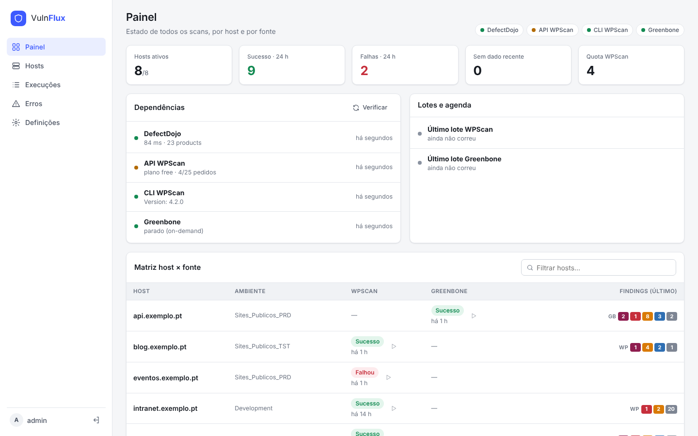

# VulnFlux

Orquestrador de scans de vulnerabilidades para os sites WordPress e hosts da organização.
Junta **WPScan** e **Greenbone/OpenVAS**, envia os resultados para o **DefectDojo** e mostra
numa única página web o que correu, o que falhou e porquê.



## O que faz

- **Gestão de hosts pela web**: adicionar, editar, desativar ou importar uma lista colada. Não há base de dados; o estado fica em ficheiros JSON.
- **WPScan diário com rotação de hosts e de chaves**: em cada lote analisa os N hosts com a tentativa mais antiga. Usa várias chaves da API, escolhe sempre a que tem mais pedidos restantes e, se uma esgotar a meio de um scan, repete com a seguinte.
- **Greenbone on-demand**: liga a stack, espera que os feeds estejam carregados, analisa e desliga.
- **Um product por host no DefectDojo**, com um test por fonte. Os findings do WPScan e do Greenbone ficam juntos sem se fecharem uns aos outros.
- **Nada é importado sem validação**: scans vazios, interrompidos, sem dados da API ou com uma queda abrupta de findings nunca fecham findings reais.
- **Visibilidade total**: matriz host × fonte, linha temporal de passos por execução, erros agrupados por causa e artefactos brutos para download.

## Arquitetura

```
                 ┌──────────────────────── VulnFlux (container) ────────────────────────┐
  Browser ──────▶│  Web (FastAPI + HTMX)   Motor (agendador + 2 filas)   Estado (JSON)    │
                 │        │                      │                                        │
                 │        ▼                      ▼                                        │
                 │  Hosts ──▶ Coletores ──▶ Validação ──▶ Normalização ──▶ Gate ──▶ Import ─┼──▶ DefectDojo
                 └───────────────┬───────────────┬────────────────────────────────────────┘
                                 │               │
                         WPScan CLI + API     GMP (socket) + gb-ctl (SSH restrito)
                                                 │
                                          Greenbone on-demand
```

| Componente | Ficheiro |
|---|---|
| Configuração (`VF_*`) | `src/vulnflux/config.py` |
| Armazenamento em ficheiros | `src/vulnflux/store.py` |
| Validação de hosts | `src/vulnflux/hosts.py` |
| WPScan (CLI, validação, quota) | `src/vulnflux/collectors/wpscan.py` |
| WPScan → Generic Findings | `src/vulnflux/converters/wpscan_generic.py` |
| Greenbone (GMP, prontidão, ciclo de vida) | `src/vulnflux/greenbone/` |
| Gates | `src/vulnflux/gates.py` |
| DefectDojo | `src/vulnflux/defectdojo.py` |
| Pipelines | `src/vulnflux/pipeline.py` |
| Agendamento e filas | `src/vulnflux/engine.py` |
| Interface web | `src/vulnflux/web/` |
| Greenbone sem UI + gb-ctl | `deploy/greenbone/` |

## Arranque rápido

```bash
git clone https://github.com/ricardodomingues10/vuln-flux && cd vuln-flux
cp .env.example .env && chmod 600 .env
# preencher no mínimo: VF_ADMIN_PASSWORD, VF_DD_URL, VF_DD_TOKEN, VF_WPSCAN_API_TOKENS
docker compose pull        # imagem pronta, publicada pelo CI em ghcr.io
docker compose up -d
```

Para construir localmente, usa `docker compose up -d --build`. O build precisa de acesso
ao apt do Debian, ao PyPI e ao RubyGems.

### Laboratório completo (WSL / portátil)

Um único comando constrói e arranca **VulnFlux + Greenbone + DefectDojo**. O token da API
do DefectDojo é obtido automaticamente e o utilizador GMP é criado no arranque do gvmd.

```bash
git clone https://github.com/ricardodomingues10/vuln-flux && cd vuln-flux
./scripts/lab.sh up        # 1.ª vez: cria o .env.lab com passwords aleatórias
nano .env.lab              # preencher VF_WPSCAN_API_TOKENS
./scripts/lab.sh restart
./scripts/lab.sh status    # serviços, URLs, credenciais, progresso dos feeds
```

| Serviço | URL | Credenciais |
|---|---|---|
| VulnFlux | http://localhost:8080 | `./scripts/lab.sh creds` |
| DefectDojo | http://localhost:8081 | `./scripts/lab.sh creds` |
| Greenbone | sem UI (GMP via socket) | utilizador `orchestrator` |

Requisitos:
- Docker Compose 2.20 ou superior.
- Cerca de 12 GB de RAM para o WSL. Define em `%UserProfile%\.wslconfig` com `[wsl2] memory=12GB swap=8GB` e corre `wsl --shutdown`.
- Cerca de 25 GB de disco.

No primeiro arranque, o Greenbone demora 30 a 90 minutos a carregar os feeds. O VulnFlux espera
sozinho pelo gate de prontidão. Outros comandos úteis: `logs <serviço>`, `rebuild` (depois de
alterar o código), `gb` (diagnóstico do Greenbone: feeds, erros, OOM, CPU, gate), `gb-restart`,
`down` e `reset` (apaga todos os dados).

No laboratório, o Greenbone fica sempre ligado. O ciclo on-demand com gb-ctl/SSH é só para produção.

### Servidor atrás de proxy ou sem Internet

- **Com proxy:** define `HTTP_PROXY`, `HTTPS_PROXY` e `NO_PROXY` no `.env`. Servem para o build e
  para a execução. O WPScan precisa de chegar a `wpscan.com`, a `data.wpscan.org` e aos sites.
  O `NO_PROXY` tem de incluir o DefectDojo e os destinos internos.
- **Pull da imagem por proxy:** o daemon do Docker precisa do seu próprio proxy, em
  `/etc/systemd/system/docker.service.d/proxy.conf`.
- **Sem acesso ao registo de imagens:** descarrega o artefacto `vulnflux-image` da última
  execução do CI (Actions) noutra máquina e carrega-o no servidor com
  `gunzip -c vulnflux-image.tar.gz | docker load`.

A interface fica em `http://127.0.0.1:8080`. Para a expor, publica-a através do Nginx Proxy
Manager com HTTPS. O cookie de sessão só é enviado por HTTPS (`VF_COOKIE_SECURE=true`).

Com o Greenbone na mesma máquina, segue primeiro o `deploy/greenbone/README.md` e arranca com:

```bash
docker compose -f docker-compose.yml -f docker-compose.greenbone.yml up -d --build
```

## Como funciona

### Pipelines

Cada execução (um host × uma fonte) passa por passos registados com início, fim e detalhe:

| WPScan | Greenbone |
|---|---|
| Preparar (BD de metadados) | Preparar task (target/task `vulnflux:<host>`) |
| Scan (`--format json --no-update`) | Scan (estado e progresso a cada 30 s) |
| Validar | Recolher report (XML) |
| Converter (Generic Findings) | Validar |
| Gate | Gate |
| Importar no DefectDojo | Importar no DefectDojo |

### O que bloqueia um import

| Situação | Tipo de erro |
|---|---|
| WPScan sem JSON, exit code diferente de 0/5, `scan_aborted` | Dados / Permanente |
| API do WPScan com erro, sem resposta (429 silencioso) ou quota a 0 durante o scan | Quota / Dependência |
| Report do Greenbone diferente de `Done`, task interrompida ou parada | Dados |
| Greenbone sem hosts analisados (alvo inacessível) | Dados |
| Greenbone não pronto (feeds a sincronizar, VTs por carregar, scanner em baixo) | Dependência |

Uma **queda abrupta** (por omissão, mais de 50% face à última execução boa, com pelo menos 5
findings antes) não bloqueia o import. Importa sem `close_old_findings` e marca a execução
como *Com avisos*.

### Modelo no DefectDojo

```
Product type  = ambiente do host       (ex.: Sites_Publicos_PRD)
Product       = nome canónico do host  (ex.: www.exemplo.pt)
Engagement    = VF_DD_ENGAGEMENT       (VulnFlux)
Test          = "WPScan" | "Greenbone"
```

O reimport usa sempre `auto_create_context=true`, `close_old_findings_product_scope=false`
e `do_not_reactivate=false`. Um finding que volte a aparecer é reaberto.

### O que o WPScan analisa e importa

O scan corre com `--enumerate vp,vt,tt,cb,dbe,bf,u1-10 --plugins-detection mixed`. É
configurável com `VF_WPSCAN_ENUMERATE` e `VF_WPSCAN_PLUGINS_DETECTION`. Sem `-e`, o WPScan
4.x não analisa plugins nem utilizadores. Tudo vai num único import (test "WPScan"):

| Resultado do WPScan | Finding no DefectDojo | Severidade |
|---|---|---|
| Vulnerabilidades do core, de plugins e de temas | um por vulnerabilidade e componente, com CVE, versão detetada e versão corrigida | pelo CVSS (Medium sem CVSS) |
| Timthumbs vulneráveis | um por vulnerabilidade e ficheiro | pelo CVSS |
| Backup do `wp-config` acessível (`cb`) | um por URL | High |
| Export da base de dados acessível (`dbe`) | um por URL | High |
| Pasta de backup acessível (`bf`) | um por URL, com o conteúdo listado | a indicada pelo WPScan |
| Utilizadores enumerados (`u`) | um por site, com a lista de usernames | Low (`VF_WPSCAN_INCLUDE_USERS`) |
| Interesting findings | um por item | Info (`VF_WPSCAN_INCLUDE_INTERESTING`) |

O JSON bruto de cada scan fica guardado como artefacto da execução.

### Chaves WPScan

`VF_WPSCAN_API_TOKENS` aceita várias chaves, separadas por vírgulas. O funcionamento é este:

1. No início de cada lote, consulta o estado de todas as chaves. O endpoint de status não gasta quota.
2. Para cada scan, escolhe a chave com mais pedidos restantes. As inválidas ou abaixo de `VF_WPSCAN_MIN_QUOTA` ficam de fora.
3. Depois do scan, atualiza a quota dessa chave com o valor que o próprio WPScan devolve.
4. Se a chave esgotar a meio do scan, marca-a como esgotada e repete o scan com a seguinte. O resultado parcial nunca é importado.
5. Quando todas esgotam, os hosts restantes do lote ficam como *Ignorado* (quota) e entram no lote seguinte.

O estado de cada chave (plano, pedidos restantes, scans feitos, última verificação) aparece
em **Definições**. As chaves nunca são gravadas em disco nem mostradas: o estado usa uma
impressão digital e os últimos 4 caracteres.

### Tipos de erro

| Tipo | Significado | O que acontece |
|---|---|---|
| Transitório | timeout, 5xx, lock | entra no lote seguinte |
| Dependência em baixo | DefectDojo, gvmd ou API indisponíveis | o lote é ignorado sem gastar quota |
| Dados inválidos | resultado não passou a validação | não importa |
| Quota esgotada | token WPScan sem pedidos | o host entra no lote seguinte |
| Permanente | não é WordPress, redireciona, credenciais erradas | é preciso rever o host |
| Configuração | falta um token ou um URL | é preciso rever o `.env` |

## Interface

- **Painel**: KPIs das últimas 24 h, estado das dependências, últimos lotes e agenda, execuções em curso, matriz host × fonte (atualiza sozinha) e falhas recentes.
- **Hosts**: lista com filtro (tecla `/`), adicionar ou editar num modal, importação em lote (`url ; ambiente ; etiquetas`), exportação JSON, ativar/desativar e “Correr agora” por fonte.
- **Execuções**: filtros por fonte, estado, tipo de erro e host. O detalhe mostra os passos, o erro com o detalhe técnico, os avisos, as estatísticas do DefectDojo (novos/fechados/reabertos) e os artefactos.
- **Erros**: falhas agrupadas por causa, com contagem e hosts afetados.
- **Definições**: configuração efetiva (com os segredos ocultos), agenda e ações manuais.

## Configuração

Toda a configuração está no `.env.example`, comentado. Os valores mais importantes:

| Variável | Omissão | Notas |
|---|---|---|
| `VF_ADMIN_PASSWORD` | — | obrigatória |
| `VF_DD_URL` / `VF_DD_TOKEN` | — | token de um utilizador com permissão de import |
| `VF_DD_CA_BUNDLE` | — | CA interna, se o DefectDojo usar um certificado privado |
| `VF_WPSCAN_API_TOKENS` | — | uma ou várias chaves; sem nenhuma, os scans WPScan nem arrancam |
| `VF_WPSCAN_CRON` / `VF_WPSCAN_BATCH_SIZE` | `37 2 * * *` / `4` | plano free: 25 pedidos/dia |
| `VF_GREENBONE_ENABLED` | `false` | |
| `VF_GREENBONE_SSH_HOST` | — | vazio = Greenbone sempre ligado, sem start/stop |

Os segredos também podem vir de Docker secrets: `/run/secrets/vf_dd_token` preenche `VF_DD_TOKEN`.

## Dados e backups

Tudo vive no volume `/data`:

```
/data/hosts.json          hosts (exportável também pela interface)
/data/state.json          saúde, lotes, estado do Greenbone
/data/runs/<id>.json      uma execução por ficheiro
/data/artifacts/<id>/     JSON/XML brutos, ficheiro enviado e resposta do DefectDojo
/data/wpscan-home/        BD de metadados do WPScan
```

As escritas são atómicas (ficheiro temporário + `fsync` + `rename`). Execuções com mais de
`VF_RETENTION_DAYS` são apagadas todos os dias às 04:11. Para fazer backup, basta copiar o volume.

A aplicação corre num único processo, com o agendador e as filas lá dentro. Não a escales
para mais réplicas.

## Migrar do n8n

1. Importa a lista de sites em **Hosts → Importar lista**, com o mesmo ambiente que o `lista_sites` usava.
2. Confirma que os nomes canónicos são iguais aos `product_name` atuais no DefectDojo. Se forem, os findings continuam nos mesmos products.
3. Os tests passam a chamar-se "WPScan" e "Greenbone". Os antigos (`WPSCAN-CORE-ON-DEMAND`, `WPSCAN-ON-DEMAND`, "Greenbone scan") deixam de ser atualizados e podem ser fechados no DefectDojo depois do primeiro ciclo bom.
4. Desliga os workflows do n8n e os agendamentos `criar_tasks_usc.sh` / `correr_tasks_usc.sh`.

## Desenvolvimento

```bash
pip install -e ".[dev]"
pytest                       # 130 testes
ruff check src tests scripts && ruff format --check src tests scripts
shellcheck deploy/greenbone/gb-ctl.sh

# Interface com dados de demonstração (sem scanners)
python scripts/seed_demo.py vf-demo-data
VF_DATA_DIR=vf-demo-data VF_ADMIN_PASSWORD=demo VF_COOKIE_SECURE=false python -m vulnflux
```

A interface não tem build: HTML (Jinja2) em `src/vulnflux/web/templates/`, uma folha de estilos
em `static/css/app.css` (cores em variáveis no topo, com modo escuro automático) e o HTMX
servido localmente. Não depende de nenhum CDN. A CSP é estrita: não há scripts nem estilos inline.

## Limitações conhecidas

- Se o VulnFlux reiniciar a meio de um lote do Greenbone, as execuções ficam como *Interrompido* e as tasks continuam a correr no gvmd. O lote seguinte deteta a task ativa e reporta *Transitório*.
- Há um único utilizador de administração, configurado por variável de ambiente.
- Não há envio de alertas por email. O painel é a fonte de verdade.
