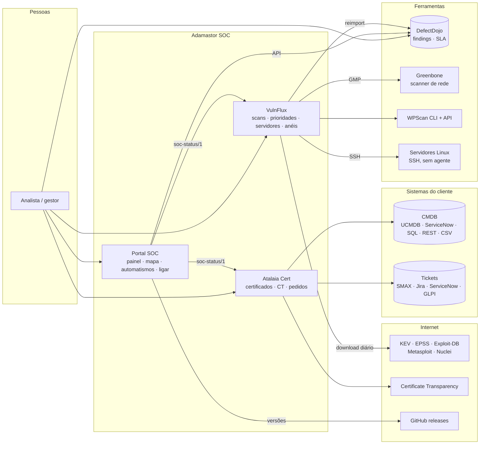
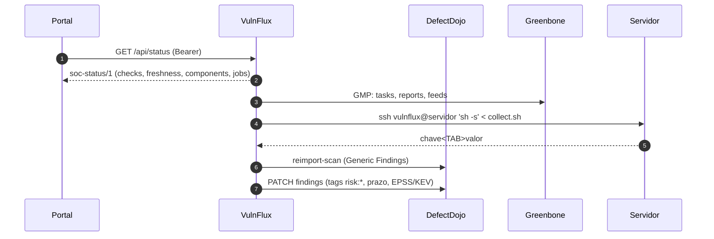

# Arquitetura do Adamastor SOC

> *"Eu sou aquele oculto e grande Cabo / A quem chamais vós outros Tormentório"*: Os Lusíadas, Canto V.
>
> O Adamastor é o gigante que guarda o Cabo das Tormentas. Este SOC guarda a organização:
> vê tudo o que passa, avisa antes da tormenta e deixa às pessoas só as decisões.

O princípio é este: **listar tudo, ligar as fontes e deixar os testes correrem sozinhos.** As pessoas
olham para os painéis e indicadores e decidem o que fazer. O que se repete faz-se sem ninguém: scans,
prioridades, verificação de servidores, atualizações por anéis, renovação de certificados, alertas.

## 1. Os componentes



| Componente | Repositório | O que faz | Interface |
|---|---|---|---|
| **Portal SOC** | `adamastor-soc/portal` | Estado de todos os serviços, dependências, versões desatualizadas, idade das listas, mapa das funções SOC, automatismos, ligar um serviço com URL + chave | `:8090` |
| **VulnFlux** | `adamastor-soc` | WPScan e Greenbone → DefectDojo, prioridade por risco P1–P4, página Servidores (saúde, hardening, atualizações por anéis) | `:8080` |
| **DefectDojo** | imagem oficial | Repositório único de findings, SLA e prioridades | `:8081` |
| **Greenbone** | imagens oficiais | Scanner de rede, sem interface: o VulnFlux controla-o por GMP e vigia os feeds | — |
| **Atalaia Cert** | `certs-watch` | Certificados da CMDB vs. os servidos, CT, renovação, pedidos no sistema de tickets do cliente | `:8088` |

Cada componente é um serviço à parte, configurado por URL. Quando o MISP, o DefectDojo ou outro
passar para uma máquina dedicada, muda-se o URL e nada mais.

## 2. Como se falam



**Contrato `soc-status/1`** (`docs/soc-status.md`): cada serviço próprio publica `GET /api/status` com
o estado, as verificações, a idade de cada lista (`freshness`), os componentes que vigia por dentro
(Greenbone, Servidores) e as tarefas agendadas (`jobs`). O portal lê só isto: qualquer serviço novo
que publique o contrato aparece no painel, no mapa e nos automatismos sem código no portal.

## 3. Tudo o que corre sozinho

| Quando | Quem | O quê |
|---|---|---|
| a cada 60 s | Portal | verifica todos os serviços, regista mudanças de estado, alerta por webhook |
| a cada 12 h | Portal | procura versões novas no GitHub (serviço desatualizado = aviso) |
| a cada 10 min | VulnFlux | saúde das dependências (DefectDojo, API WPScan, CLI, Greenbone) |
| a cada 10 min | VulnFlux | portões dos anéis de atualização (observação, aprovação) |
| diário 02:37 | VulnFlux | lote WPScan (rotação de hosts e de chaves) |
| dia 26, 01:13 | VulnFlux | lote Greenbone (liga, espera pelos feeds, analisa, desliga) |
| diário 06:17 | VulnFlux | KEV/EPSS/exploits → prioridades e prazos no DefectDojo |
| a cada 6 h | VulnFlux | verificação de todos os servidores (saúde, hardening, atualizações) → DefectDojo |
| terça 03:41 | VulnFlux | ciclo de atualizações por anéis 0 → 3 |
| diário 04:11 | VulnFlux | limpeza das execuções antigas (retenção) |
| diário 06:15 | Atalaia Cert | pipeline: CMDB, APIs, tickets, CT, scan TLS, avaliação, relatório |
| depois de cada import | VulnFlux | recálculo das prioridades do host |
| segunda 06:00 | Dependabot | pull requests com dependências novas, testadas pelo CI |

A página **Automatismos** do portal mostra esta tabela ao vivo, com o resultado da última vez e um
calendário dos próximos 7 dias. Todos os horários mudam por variável de ambiente (`VF_*_CRON`,
`CERTWATCH_PIPELINE_DAILY_AT`).

## 4. Ligar coisas novas

| Quero ligar… | Onde | O que faço |
|---|---|---|
| um serviço (Vaultwarden, Grafana, MISP, TheHive…) | Portal → **Ligar um serviço** | colo o URL e, se precisar, a chave; o portal descobre o produto, testa e grava |
| um serviço do catálogo, com afinação | Portal → **Catálogo** | escolho o modelo, ajusto as verificações |
| um servidor Linux | VulnFlux → **Servidores** | colo uma linha no servidor (conta + chave + sudo limitado) e adiciono-o |
| um site WordPress ou host de rede | VulnFlux → **Hosts** | URL e/ou alvo do Greenbone, contexto de risco |
| a CMDB ou o sistema de tickets de um cliente | Atalaia → **Sistema → Ligações** | tipo, endereço, chave, mapeamento; Testar mostra os registos traduzidos |

## 5. Onde está cada coisa

| Dado | Onde | Backup |
|---|---|---|
| Hosts, execuções, relatórios dos servidores, ciclos | volume `/data` do VulnFlux (JSON, escrita atómica) | sim |
| Chave SSH do VulnFlux e chaves fixadas dos servidores | `/data/ssh` | sim (a privada nunca sai) |
| Serviços criados na interface e as suas chaves | volume do portal (`services.json`, `secrets/` 0600) | sim |
| Findings, SLA, prioridades | PostgreSQL do DefectDojo | sim |
| Certificados, pedidos, ligações (credenciais cifradas) | PostgreSQL do Atalaia | sim |
| Feeds de ameaça (KEV, EPSS…) | cache em `/data/risk` | não (voltam a descarregar) |

## 6. Segurança

- **Só leitura por omissão.** O portal e a deteção fazem só GET. Os servidores ficam em "só verificar"
  até alguém escolher o modo de atualização.
- **Segredos fora do código e do YAML:** Docker secrets, ficheiros 0600, ou cifrados na base de dados
  (Atalaia). A interface nunca volta a mostrar uma chave guardada.
- **SSH sem agente e com o mínimo:** conta sem palavra-passe, chave com `no-pty` e sem túneis,
  sudo limitado aos comandos exatos, validado com `visudo`. Chaves dos hosts fixadas (TOFU): uma
  mudança para a ligação até alguém confirmar.
- **Atualizações com rede de segurança:** anéis, observação entre anéis, aprovação no anel crítico,
  pré/pós-verificação, paragem à primeira falha.
- **Nada chega ao DefectDojo sem validação:** um scan vazio, interrompido ou com uma queda abrupta de
  findings nunca fecha findings reais.
- **Interfaces:** CSP estrita (sem scripts nem estilos inline), CSRF em tudo o que escreve, sessão
  com expiração, limite de tentativas de login.

## 7. Atualizar o próprio SOC

```bash
./scripts/lab.sh update     # git pull, guarda as imagens atuais, descarrega/constrói, arranca e verifica
./scripts/lab.sh rollback   # volta às imagens guardadas pelo último update
```

Se depois de atualizar o VulnFlux ou o portal não responderem, o `update` volta atrás sozinho. As
dependências chegam por pull requests semanais (Dependabot), e cada uma passa pelo CI: testes, lint e
um laboratório real com DefectDojo, SSH e o portal antes de entrar.

## 8. Mapa dos ficheiros

```
adamastor-soc/
├── src/vulnflux/            VulnFlux
│   ├── collectors/          WPScan
│   ├── greenbone/           GMP, prontidão, ciclo de vida
│   ├── risk/                KEV/EPSS/exploits → prioridades e SLA
│   ├── servers/             Servidores: SSH, recolha, hardening, findings, anéis
│   └── web/                 interface (FastAPI + HTMX)
├── portal/                  Portal SOC (serviço separado)
│   └── src/socportal/       registo, verificações, deteção, catálogo, mapa, automatismos
├── deploy/                  Greenbone sem UI, portal do laboratório, Atalaia, servidor de demo
├── scripts/lab.sh           laboratório completo (WSL/portátil)
└── docs/                    este documento, contrato soc-status, imagens
```
